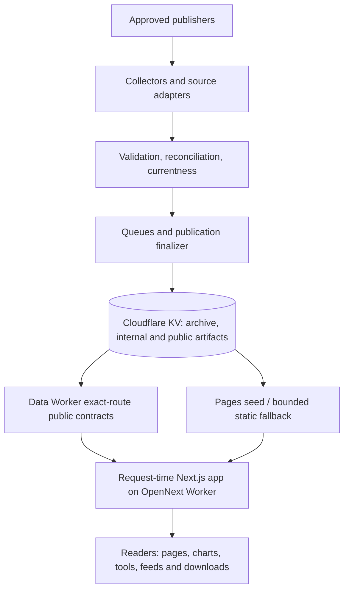
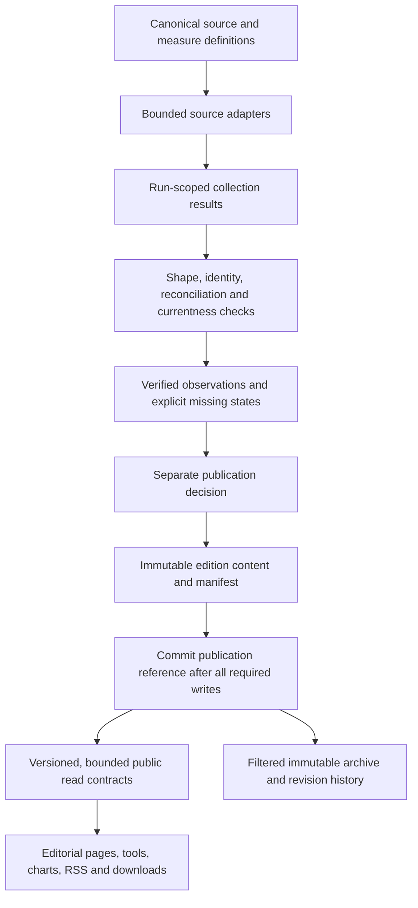

# V1 architecture record

**Reviewed:** 12 October 2026.
**Purpose:** current boundaries, candidate findings, interfaces, and decisions. Work sequencing is in [MASTER-DELIVERY-PLAN.md](MASTER-DELIVERY-PLAN.md).

## Current system

The current production app is Next.js/OpenNext on a Cloudflare Worker. A separate data Worker serves explicit public contracts; Pages is a bounded static fallback. Collectors, Queue state, KV keys, credentials and private diagnostics remain private. Source membership/retrieval policy is in `worker/feed-registry.js`; public shapes are defined by contracts.

In the current publisher, Queue collection writes section fragments; finalisation assembles retained/current evidence; archive, internal snapshot, public artifact, history and status are separate writes. Archive content, summary and index are also separate writes. A failure between writes can expose disagreement. Existing section fragments are shared per section rather than scoped to one run. The release architecture must close both gaps or provide a demonstrated consistency protocol before publication is advertised.

## Target logical flow

This is a logical model, not a microservice mandate. Reuse modules that already own a boundary cleanly. The design must keep product route availability separate from evidence publication and must fail closed for unknown sources and decisions.

## Editorial design exploration

The existing MagicPath project compared three directions against live, verified publication content. A03 recommends **Direction 01, “The evidence desk,”** as the shared P01 grammar because it best extends the current ink/paper/vermillion identity and supports dated, sourced editorial leads and archive context. Borrow Direction 02's typographic confidence selectively and Direction 03's clear search, availability and comparison entry points. This is a design recommendation, not production acceptance; adopt it through the existing application and verify real routes.

The concept must label the debt observation provisional near the lead and distinguish the site's current topics from the number of current measures. At review time the homepage showed one current topic and five unavailable topics; the measure catalog showed 38 registered definitions but only two current debt measures. Do not infer that a static canvas proves keyboard behavior, focus, contrast, reduced motion, responsive behavior, or a functioning route. Those checks remain in P01/A14 acceptance.

## Domain ownership contract to resolve in Wave 1

| Concept | Required canonical responsibility | Current decision |
|---|---|---|
| Source | Identity, publisher, family, provenance and retrieval policy | Registry currently owns membership/retrieval; audit overlapping metadata before migration. |
| Source edition | Specific publisher release and publication date | Preserve original publisher identity; ensure references survive refreshes. |
| Measure definition | Concept, unit, geography, frequency and comparison rules | `contracts/measure-definitions.json` is an existing candidate owner; verify generated projections. |
| Observation | Value or explicit unavailable state, period and geography | Must not encode missing/stale/incomplete as zero. |
| Evidence record | Link validated observations to source edition and verification state | Must remain distinct from publication approval. |
| Publication decision | Published, held, retired or other explicitly defined state | Existing booleans remain fail-closed until approved migration. |
| Public edition | Immutable reader-facing, policy-filtered version | Needs committed reference only after required archive/public writes succeed. |
| Revision | New period, changed historical value, metadata, method or withdrawal | Do not label retrieval-only change as a revision or story. |
| Release event | Publisher-announced date/status with unknown and changed states | Keep separate from measurement publication state. |
| Citation | Link reader claim to primary publisher and edition | Required from chart/story/export back to source. |

## Public/private interface inventory

`contracts/public-surfaces.json` lists the data Worker routes. The site Worker serves page routes. Public data responses must be versioned/validated, bounded, source-attributed and publication-filtered; errors must not reveal operational state. Health is a separate readiness contract. Static output and fallback recovery must apply the same current publication decisions as the live data Worker.

The production observation on 12 October showed a mismatch: `/data/health.json` said degraded and named missing `nhsStats`; the filtered metrics snapshot also said degraded but omitted that missing ID. The full internal readiness manifest must be projected consistently or remain in health only with clearly defined public snapshot semantics.

## PR #214 assessment (separate review)

PR #214 is an architectural rework and is not approved as a wholesale integration. The inspected diff review recommends:

- **Retain for adaptation:** domain vocabulary/validation; canonical source catalog with legacy projections; Queue module extraction; public-artifact validation; reading readiness from internal state.
- **Rewrite before use:** route policy currently couples published data with section/measure/source/calendar page availability; publisher continues after archive failure; new domain model is not wired through collection/publication and cannot represent explicit unavailable observations; collector fragments remain shared per-section keys.
- **Reject as written:** Pages recovery accepts a prior public projection and serves it unchanged, so it can bypass current publication policy if a source was newly held. This is a latent path; current public Pages snapshot was 503 during the audit.
- **Missing regressions before those paths can integrate:** newly-held stale Pages seed; archive-write failure and commit ordering; cross-run fragment isolation; readiness/missing-manifest consistency.

These are review findings about the inspected diff, not a statement of current PR status. Recheck the live diff before an integration decision.

## Wave 1 architecture decisions

1. Assign canonical owners for source identity, retrieval, measures, publication decisions and public routes; update `AGENTS.md` only with the approved outcome.
2. Define run identity, idempotency and isolation. Older verified observations may be reused only inside their original validity window and with provenance retained.
3. Use a publish-after-write protocol with a stable edition manifest/reference so no edition is advertised before every required record is readable. Measure actual KV consistency and resource limits.
4. Specify the snapshot-versus-health readiness contract; missing required evidence must not disappear while degraded state remains.
5. Reapply current policy during Pages seed recovery, static generation, archives, feeds, downloads, discovery indexes and embedded data.
6. Make source failures and retry exhaustion explicit; retries cannot convert failure into success or overwrite a valid status.

## Runtime, deployment and cost

Keep the existing Workers/OpenNext architecture while it serves measured reader and evidence needs. Evaluate alternatives only against observed limits. Cloudflare is the current host, not a permanent ceiling. Do not incur paid spend without user approval. Code release health and source recovery/readiness are separate operational questions.
